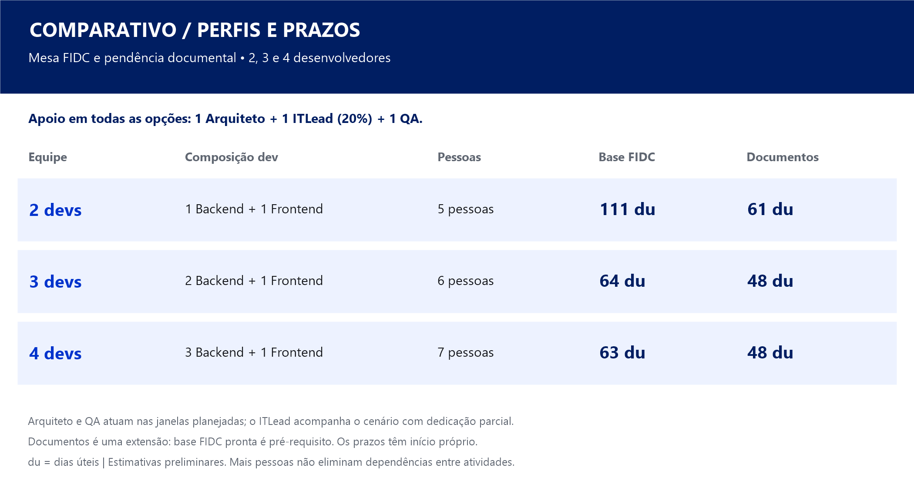
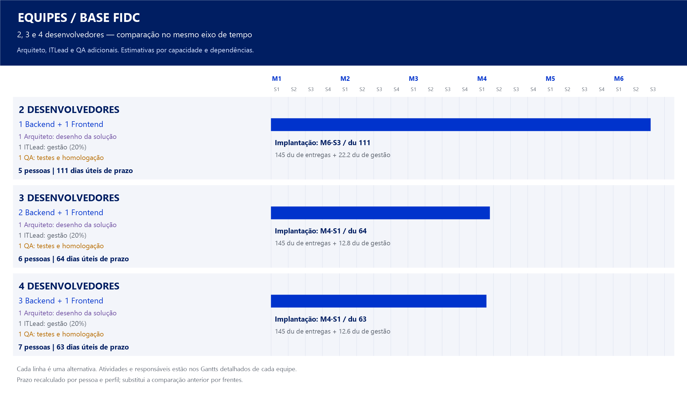
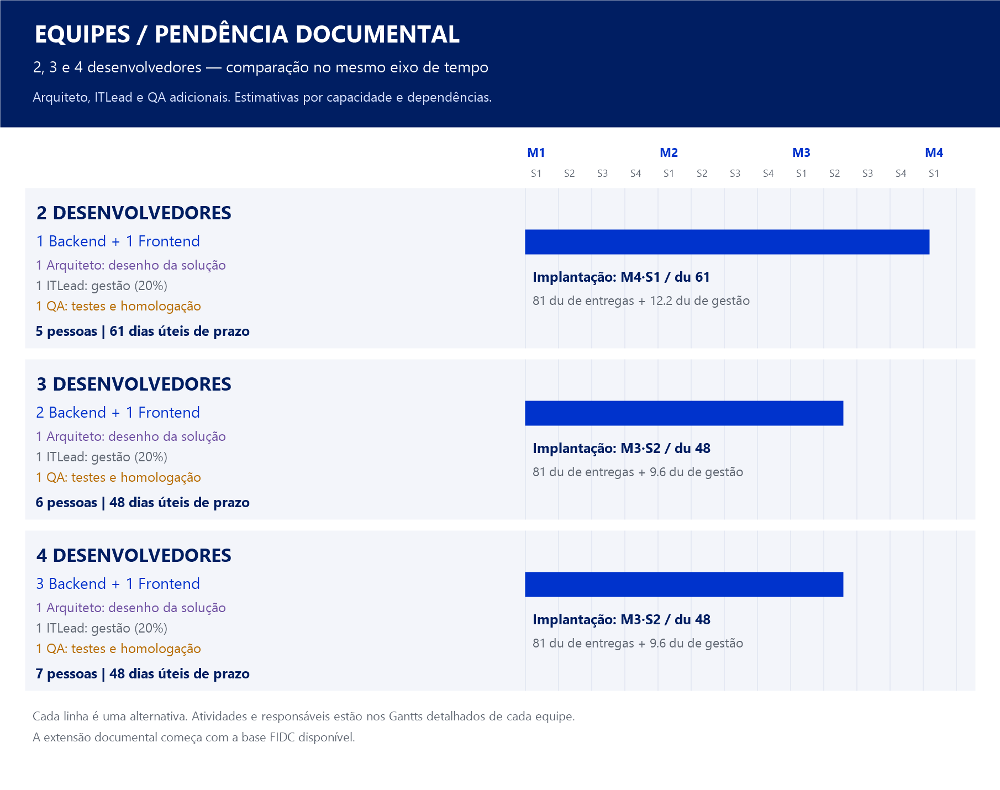

# Cronogramas por perfil — Mesa FIDC e documentos

> A [estrutura do projeto por épico e features](estrutura-projeto-nova-mesa.md) distribui o escopo em Entrega 1 (APIs), Entrega 2 (status e julgamental mínima) e Entrega 3 (pendências e arquivos). A extensão documental D3 pertence à Entrega 3.

> Para o recorte com data-alvo de **11/01/2027**, consulte a [Entrega 1 — simulação e análise automática](entrega-0-nova-mesa.md). As comparações abaixo abrangem mesa e documentos e precisam de reestimativa para o novo escopo e a capacidade realocada.

Comparação de capacidade com **2, 3 e 4 desenvolvedores**, aplicada separadamente à base FIDC e à extensão de pendência documental. Atualização: 2026-11-11.

## Equipes e premissas

| Desenvolvedores | Backend | Frontend | Arquiteto | ITLead | QA | Pessoas envolvidas |
| --- | --- | --- | --- | --- | --- | --- |
| 2 | 1 | 1 | 1 | 1 | 1 | 5 |
| 3 | 2 | 1 | 1 | 1 | 1 | 6 |
| 4 | 3 | 1 | 1 | 1 | 1 | 7 |

**Desenvolvedores significa Backend + Frontend.** Arquiteto, ITLead e QA são profissionais adicionais. Foi mantido um Frontend e ampliado o Backend porque o backlog concentra APIs, estados, eventos, integrações e validação documental. É uma composição proposta para comparação, não uma equipe já confirmada.

| Perfil | Responsabilidade | Disponibilidade usada no cálculo |
| --- | --- | --- |
| Arquiteto | Desenho da solução, componentes, contratos e responsabilidades | 1 profissional nos 10 dias úteis do desenho; consultas posteriores sob demanda, sem esforço adicional estimado |
| Backend | Serviços, APIs, persistência, eventos, autorização, validação e implantação | Cada desenvolvedor executa uma atividade por vez, durante todo o cenário |
| Frontend | Telas da mesa, experiência do cliente, upload e consumo das APIs | 1 desenvolvedor; uma atividade por vez |
| ITLead | Planejamento, gestão, dependências, riscos e acompanhamento das entregas | 1 profissional com reserva estimada de 20% ao longo de todo o cenário; não executa desenvolvimento |
| QA | Carga, resiliência, testes integrados e homologação | 1 profissional disponível nas janelas indicadas; uma atividade por vez |

- M1 é o início relativo de cada cenário. Mês = 20 dias úteis; semana = 5 dias úteis. Datas de início, férias e feriados ainda não foram informados.
- O cenário documental pressupõe a base FIDC pronta. Seus pré-requisitos F3 ficam registrados nas tabelas. As duas linhas do tempo não representam execução simultânea pelas mesmas pessoas.
- O esforço das entregas foi preservado: 145 dias úteis na base e 81 na extensão. Atividades mistas foram divididas entre Backend e Frontend, com o mesmo esforço total. Os sufixos B, F e Q identificam essas partes; as divisões são estimativas de planejamento.
- QA assume os testes transversais e a homologação. Testes unitários, revisão e correções da própria entrega permanecem no esforço do desenvolvedor; não foi criada uma etapa QA adicional para cada story.
- A barra de ITLead cobre todo o período, com dedicação de 20%; sua extensão visual não significa dedicação integral. O esforço de gestão é mostrado separadamente e não está nos 145/81 dias originais.
- Provisionamento e operação técnica são atribuídos ao Backend neste modelo de cinco perfis, pressupondo acesso e capacidade para infraestrutura. Esperas por uma equipe de plataforma ou pelo parceiro não estão estimadas.
- As APIs precedem as telas correspondentes. Cada profissional tem agenda própria; não há sobreposição de atividades na mesma pessoa. A escolha prioriza o início possível e, em empate, o maior caminho restante de dependências. O resultado não é uma promessa de prazo mínimo.
- Mais desenvolvedores não dividem automaticamente o prazo: dependências, um Frontend e um QA podem limitar o ganho. Comparações assumem igual produtividade, sem prazo adicional de onboarding.

## Comparação de prazos

| Cenário | Devs | Composição | Prazo (du) | Implantação | Esforço das entregas (du) | Gestão ITLead (du equivalentes) |
| --- | --- | --- | --- | --- | --- | --- |
| Base FIDC | 2 | 1 Backend + 1 Frontend | 111 | M6·S3 | 145 | 22.2 |
| Base FIDC | 3 | 2 Backend + 1 Frontend | 64 | M4·S1 | 145 | 12.8 |
| Base FIDC | 4 | 3 Backend + 1 Frontend | 63 | M4·S1 | 145 | 12.6 |
| Pendência documental | 2 | 1 Backend + 1 Frontend | 61 | M4·S1 | 81 | 12.2 |
| Pendência documental | 3 | 2 Backend + 1 Frontend | 48 | M3·S2 | 81 | 9.6 |
| Pendência documental | 4 | 3 Backend + 1 Frontend | 48 | M3·S2 | 81 | 9.6 |

Os totais de pessoas não representam dedicação integral de todos durante todo o período. A carga de cada perfil aparece nas tabelas abaixo. Estes cenários substituem, para comparação de equipes, os prazos anteriores calculados por frentes de trabalho.

## Base FIDC

### 2 desenvolvedores — 1 Backend + 1 Frontend

[Abrir Gantt com todas as atividades e perfis](../diagramas/cronograma-fidc-2-devs.png)

Carga das entregas por perfil: Backend: 108 du; Frontend: 15 du; Arquiteto: 10 du; QA: 12 du. Gestão adicional: 22.2 du equivalentes.

| ID | Atividade | Perfil / responsável | Duração (du) | Início (du) | Fim (du) | Depende de | Pré-requisito da base |
| --- | --- | --- | --- | --- | --- | --- | --- |
| F3-01 | Definir runtime e região no GCP e o produto do MySQL cloud | Backend 1 | 5 | 1 | 5 | — | — |
| F3-02 | Definir contratos: API de entrada, identificação FIDC, API do parceiro e eventos | Backend 1 | 5 | 6 | 10 | — | — |
| F3-03 | Definir o mTLS: autoridade certificadora, emissão, rotação, revogação e vínculo ao parceiro | Backend 1 | 5 | 36 | 40 | — | — |
| F3-04 | Mapear os pontos de extensão da PCRE-JULG \| Argos para a mesa | Frontend 1 | 5 | 1 | 5 | — | — |
| F3-05 | Definir timeout, retentativas e tratamento de falhas do callback | Backend 1 | 3 | 53 | 55 | F3-02 | — |
| F3-06 | Desenho de arquitetura da solução: componentes, integrações, dados, segurança e implantação | Arquiteto 1 | 10 | 1 | 10 | — | — |
| F3-07 | Provisionar ambientes no GCP e pipeline de CI/CD da esteira | Backend 1 | 4 | 11 | 14 | F3-01, F3-06 | — |
| F3-08 | Provisionar o MySQL cloud da esteira: instância, rede, usuários e backup | Backend 1 | 4 | 20 | 23 | F3-01, F3-06 | — |
| F3-09 | Provisionar tópicos, schemas e ACLs no Confluent Kafka | Backend 1 | 4 | 32 | 35 | F3-02, F3-06 | — |
| F3-10 | Provisionar a terminação mTLS na entrada e os certificados de homologação | Backend 1 | 4 | 49 | 52 | F3-03, F3-07 | — |
| F3-11 | Observabilidade: logs, métricas, alertas e rastreio por protocolo | Backend 1 | 3 | 102 | 104 | F3-07 | — |
| F3-12 | Testes de carga e resiliência | QA 1 | 5 | 99 | 103 | F3-27, F3-29 | — |
| F3-13 | Teste ponta a ponta com o parceiro em homologação | QA 1 | 5 | 104 | 108 | F3-10, F3-21, F3-25F, F3-27, F3-29, F3-30 | — |
| F3-14 | Plano de implantação, runbook e onboarding do parceiro | Backend 1 | 3 | 105 | 107 | F3-11, F3-29 | — |
| F3-15Q | Homologação da base FIDC com o negócio | QA 1 | 2 | 109 | 110 | F3-12, F3-13, F3-14 | — |
| F3-15B | Implantar a base FIDC após homologação | Backend 1 | 1 | 111 | 111 | F3-15Q | — |
| F3-16 | Receber a solicitação FIDC por API síncrona e validar o payload | Backend 1 | 5 | 15 | 19 | F3-02, F3-07 | — |
| F3-17 | Persistir a solicitação e devolver o protocolo único de aceite | Backend 1 | 3 | 24 | 26 | F3-08, F3-16 | — |
| F3-18 | Controlar os estados: pendente, em análise, derivada, concluída, indisponível e reprocessada | Backend 1 | 5 | 27 | 31 | F3-17 | — |
| F3-19 | Solicitar a decisão à PDEC e registrar o resultado automático | Backend 1 | 5 | 41 | 45 | F3-18 | — |
| F3-20 | Publicar a derivação para a mesa no Kafka, com outbox | Backend 1 | 10 | 56 | 65 | F3-09, F3-19 | — |
| F3-21 | Garantir idempotência: a mesma chave recupera o mesmo protocolo | Backend 1 | 5 | 79 | 83 | F3-17 | — |
| F3-22B | Consumir derivações e expor API de fila e dados da mesa | Backend 1 | 3 | 46 | 48 | F3-04, F3-09 | — |
| F3-22F | Exibir a fila única FIDC na PCRE-JULG | Frontend 1 | 2 | 49 | 50 | F3-22B | — |
| F3-23 | Mesa exibe os dados da solicitação e o resultado da PDEC | Frontend 1 | 5 | 51 | 55 | F3-22F | — |
| F3-24B | API de decisão manual e publicação no Kafka | Backend 1 | 3 | 76 | 78 | F3-23 | — |
| F3-24F | Tela para registrar a decisão manual | Frontend 1 | 2 | 79 | 80 | F3-24B | — |
| F3-25B | Autorizar os perfis do analista nas APIs | Backend 1 | 2 | 94 | 95 | F3-22F | — |
| F3-25F | Aplicar permissões na interface da mesa | Frontend 1 | 1 | 96 | 96 | F3-25B | — |
| F3-26 | Esteira consome a decisão manual e consolida o resultado | Backend 1 | 5 | 84 | 88 | F3-20, F3-24F | — |
| F3-27 | Impedir que resultado duplicado ou tardio sobrescreva decisão finalizada | Backend 1 | 3 | 96 | 98 | F3-26 | — |
| F3-28 | Notificar o resultado na API do parceiro, com mTLS | Backend 1 | 10 | 66 | 75 | F3-05, F3-10, F3-19 | — |
| F3-29 | Registrar as tentativas e reprocessar as falhas do callback | Backend 1 | 5 | 89 | 93 | F3-28 | — |
| F3-30 | Manter a trilha de auditoria da solicitação | Backend 1 | 3 | 99 | 101 | F3-18 | — |
| GESTAO | Gestão de riscos, dependências e entregas — 20% de dedicação | ITLead 1 | 22.2 equivalentes | 1 | 111 | Transversal | — |

### 3 desenvolvedores — 2 Backend + 1 Frontend

[Abrir Gantt com todas as atividades e perfis](../diagramas/cronograma-fidc-3-devs.png)

Carga das entregas por perfil: Backend: 108 du; Frontend: 15 du; Arquiteto: 10 du; QA: 12 du. Gestão adicional: 12.8 du equivalentes.

| ID | Atividade | Perfil / responsável | Duração (du) | Início (du) | Fim (du) | Depende de | Pré-requisito da base |
| --- | --- | --- | --- | --- | --- | --- | --- |
| F3-01 | Definir runtime e região no GCP e o produto do MySQL cloud | Backend 1 | 5 | 1 | 5 | — | — |
| F3-02 | Definir contratos: API de entrada, identificação FIDC, API do parceiro e eventos | Backend 2 | 5 | 1 | 5 | — | — |
| F3-03 | Definir o mTLS: autoridade certificadora, emissão, rotação, revogação e vínculo ao parceiro | Backend 1 | 5 | 6 | 10 | — | — |
| F3-04 | Mapear os pontos de extensão da PCRE-JULG \| Argos para a mesa | Frontend 1 | 5 | 1 | 5 | — | — |
| F3-05 | Definir timeout, retentativas e tratamento de falhas do callback | Backend 2 | 3 | 6 | 8 | F3-02 | — |
| F3-06 | Desenho de arquitetura da solução: componentes, integrações, dados, segurança e implantação | Arquiteto 1 | 10 | 1 | 10 | — | — |
| F3-07 | Provisionar ambientes no GCP e pipeline de CI/CD da esteira | Backend 2 | 4 | 11 | 14 | F3-01, F3-06 | — |
| F3-08 | Provisionar o MySQL cloud da esteira: instância, rede, usuários e backup | Backend 1 | 4 | 11 | 14 | F3-01, F3-06 | — |
| F3-09 | Provisionar tópicos, schemas e ACLs no Confluent Kafka | Backend 2 | 4 | 15 | 18 | F3-02, F3-06 | — |
| F3-10 | Provisionar a terminação mTLS na entrada e os certificados de homologação | Backend 2 | 4 | 22 | 25 | F3-03, F3-07 | — |
| F3-11 | Observabilidade: logs, métricas, alertas e rastreio por protocolo | Backend 2 | 3 | 52 | 54 | F3-07 | — |
| F3-12 | Testes de carga e resiliência | QA 1 | 5 | 52 | 56 | F3-27, F3-29 | — |
| F3-13 | Teste ponta a ponta com o parceiro em homologação | QA 1 | 5 | 57 | 61 | F3-10, F3-21, F3-25F, F3-27, F3-29, F3-30 | — |
| F3-14 | Plano de implantação, runbook e onboarding do parceiro | Backend 1 | 3 | 55 | 57 | F3-11, F3-29 | — |
| F3-15Q | Homologação da base FIDC com o negócio | QA 1 | 2 | 62 | 63 | F3-12, F3-13, F3-14 | — |
| F3-15B | Implantar a base FIDC após homologação | Backend 2 | 1 | 64 | 64 | F3-15Q | — |
| F3-16 | Receber a solicitação FIDC por API síncrona e validar o payload | Backend 1 | 5 | 15 | 19 | F3-02, F3-07 | — |
| F3-17 | Persistir a solicitação e devolver o protocolo único de aceite | Backend 1 | 3 | 20 | 22 | F3-08, F3-16 | — |
| F3-18 | Controlar os estados: pendente, em análise, derivada, concluída, indisponível e reprocessada | Backend 1 | 5 | 23 | 27 | F3-17 | — |
| F3-19 | Solicitar a decisão à PDEC e registrar o resultado automático | Backend 1 | 5 | 28 | 32 | F3-18 | — |
| F3-20 | Publicar a derivação para a mesa no Kafka, com outbox | Backend 1 | 10 | 33 | 42 | F3-09, F3-19 | — |
| F3-21 | Garantir idempotência: a mesma chave recupera o mesmo protocolo | Backend 2 | 5 | 26 | 30 | F3-17 | — |
| F3-22B | Consumir derivações e expor API de fila e dados da mesa | Backend 2 | 3 | 19 | 21 | F3-04, F3-09 | — |
| F3-22F | Exibir a fila única FIDC na PCRE-JULG | Frontend 1 | 2 | 22 | 23 | F3-22B | — |
| F3-23 | Mesa exibe os dados da solicitação e o resultado da PDEC | Frontend 1 | 5 | 24 | 28 | F3-22F | — |
| F3-24B | API de decisão manual e publicação no Kafka | Backend 2 | 3 | 31 | 33 | F3-23 | — |
| F3-24F | Tela para registrar a decisão manual | Frontend 1 | 2 | 34 | 35 | F3-24B | — |
| F3-25B | Autorizar os perfis do analista nas APIs | Backend 1 | 2 | 48 | 49 | F3-22F | — |
| F3-25F | Aplicar permissões na interface da mesa | Frontend 1 | 1 | 50 | 50 | F3-25B | — |
| F3-26 | Esteira consome a decisão manual e consolida o resultado | Backend 1 | 5 | 43 | 47 | F3-20, F3-24F | — |
| F3-27 | Impedir que resultado duplicado ou tardio sobrescreva decisão finalizada | Backend 2 | 3 | 49 | 51 | F3-26 | — |
| F3-28 | Notificar o resultado na API do parceiro, com mTLS | Backend 2 | 10 | 34 | 43 | F3-05, F3-10, F3-19 | — |
| F3-29 | Registrar as tentativas e reprocessar as falhas do callback | Backend 2 | 5 | 44 | 48 | F3-28 | — |
| F3-30 | Manter a trilha de auditoria da solicitação | Backend 1 | 3 | 50 | 52 | F3-18 | — |
| GESTAO | Gestão de riscos, dependências e entregas — 20% de dedicação | ITLead 1 | 12.8 equivalentes | 1 | 64 | Transversal | — |

### 4 desenvolvedores — 3 Backend + 1 Frontend

[Abrir Gantt com todas as atividades e perfis](../diagramas/cronograma-fidc-4-devs.png)

Carga das entregas por perfil: Backend: 108 du; Frontend: 15 du; Arquiteto: 10 du; QA: 12 du. Gestão adicional: 12.6 du equivalentes.

| ID | Atividade | Perfil / responsável | Duração (du) | Início (du) | Fim (du) | Depende de | Pré-requisito da base |
| --- | --- | --- | --- | --- | --- | --- | --- |
| F3-01 | Definir runtime e região no GCP e o produto do MySQL cloud | Backend 1 | 5 | 1 | 5 | — | — |
| F3-02 | Definir contratos: API de entrada, identificação FIDC, API do parceiro e eventos | Backend 2 | 5 | 1 | 5 | — | — |
| F3-03 | Definir o mTLS: autoridade certificadora, emissão, rotação, revogação e vínculo ao parceiro | Backend 3 | 5 | 1 | 5 | — | — |
| F3-04 | Mapear os pontos de extensão da PCRE-JULG \| Argos para a mesa | Frontend 1 | 5 | 1 | 5 | — | — |
| F3-05 | Definir timeout, retentativas e tratamento de falhas do callback | Backend 1 | 3 | 6 | 8 | F3-02 | — |
| F3-06 | Desenho de arquitetura da solução: componentes, integrações, dados, segurança e implantação | Arquiteto 1 | 10 | 1 | 10 | — | — |
| F3-07 | Provisionar ambientes no GCP e pipeline de CI/CD da esteira | Backend 2 | 4 | 11 | 14 | F3-01, F3-06 | — |
| F3-08 | Provisionar o MySQL cloud da esteira: instância, rede, usuários e backup | Backend 3 | 4 | 11 | 14 | F3-01, F3-06 | — |
| F3-09 | Provisionar tópicos, schemas e ACLs no Confluent Kafka | Backend 1 | 4 | 11 | 14 | F3-02, F3-06 | — |
| F3-10 | Provisionar a terminação mTLS na entrada e os certificados de homologação | Backend 3 | 4 | 15 | 18 | F3-03, F3-07 | — |
| F3-11 | Observabilidade: logs, métricas, alertas e rastreio por protocolo | Backend 2 | 3 | 18 | 20 | F3-07 | — |
| F3-12 | Testes de carga e resiliência | QA 1 | 5 | 51 | 55 | F3-27, F3-29 | — |
| F3-13 | Teste ponta a ponta com o parceiro em homologação | QA 1 | 5 | 56 | 60 | F3-10, F3-21, F3-25F, F3-27, F3-29, F3-30 | — |
| F3-14 | Plano de implantação, runbook e onboarding do parceiro | Backend 1 | 3 | 48 | 50 | F3-11, F3-29 | — |
| F3-15Q | Homologação da base FIDC com o negócio | QA 1 | 2 | 61 | 62 | F3-12, F3-13, F3-14 | — |
| F3-15B | Implantar a base FIDC após homologação | Backend 2 | 1 | 63 | 63 | F3-15Q | — |
| F3-16 | Receber a solicitação FIDC por API síncrona e validar o payload | Backend 1 | 5 | 15 | 19 | F3-02, F3-07 | — |
| F3-17 | Persistir a solicitação e devolver o protocolo único de aceite | Backend 3 | 3 | 20 | 22 | F3-08, F3-16 | — |
| F3-18 | Controlar os estados: pendente, em análise, derivada, concluída, indisponível e reprocessada | Backend 2 | 5 | 23 | 27 | F3-17 | — |
| F3-19 | Solicitar a decisão à PDEC e registrar o resultado automático | Backend 1 | 5 | 28 | 32 | F3-18 | — |
| F3-20 | Publicar a derivação para a mesa no Kafka, com outbox | Backend 3 | 10 | 33 | 42 | F3-09, F3-19 | — |
| F3-21 | Garantir idempotência: a mesma chave recupera o mesmo protocolo | Backend 1 | 5 | 23 | 27 | F3-17 | — |
| F3-22B | Consumir derivações e expor API de fila e dados da mesa | Backend 2 | 3 | 15 | 17 | F3-04, F3-09 | — |
| F3-22F | Exibir a fila única FIDC na PCRE-JULG | Frontend 1 | 2 | 18 | 19 | F3-22B | — |
| F3-23 | Mesa exibe os dados da solicitação e o resultado da PDEC | Frontend 1 | 5 | 20 | 24 | F3-22F | — |
| F3-24B | API de decisão manual e publicação no Kafka | Backend 3 | 3 | 25 | 27 | F3-23 | — |
| F3-24F | Tela para registrar a decisão manual | Frontend 1 | 2 | 28 | 29 | F3-24B | — |
| F3-25B | Autorizar os perfis do analista nas APIs | Backend 1 | 2 | 20 | 21 | F3-22F | — |
| F3-25F | Aplicar permissões na interface da mesa | Frontend 1 | 1 | 25 | 25 | F3-25B | — |
| F3-26 | Esteira consome a decisão manual e consolida o resultado | Backend 1 | 5 | 43 | 47 | F3-20, F3-24F | — |
| F3-27 | Impedir que resultado duplicado ou tardio sobrescreva decisão finalizada | Backend 3 | 3 | 48 | 50 | F3-26 | — |
| F3-28 | Notificar o resultado na API do parceiro, com mTLS | Backend 2 | 10 | 33 | 42 | F3-05, F3-10, F3-19 | — |
| F3-29 | Registrar as tentativas e reprocessar as falhas do callback | Backend 2 | 5 | 43 | 47 | F3-28 | — |
| F3-30 | Manter a trilha de auditoria da solicitação | Backend 2 | 3 | 28 | 30 | F3-18 | — |
| GESTAO | Gestão de riscos, dependências e entregas — 20% de dedicação | ITLead 1 | 12.6 equivalentes | 1 | 63 | Transversal | — |

## Pendência documental

### 2 desenvolvedores — 1 Backend + 1 Frontend

[Abrir Gantt com todas as atividades e perfis](../diagramas/cronograma-pendencia-documental-2-devs.png)

Carga das entregas por perfil: Backend: 54 du; Arquiteto: 10 du; Frontend: 12 du; QA: 5 du. Gestão adicional: 12.2 du equivalentes.

| ID | Atividade | Perfil / responsável | Duração (du) | Início (du) | Fim (du) | Depende de | Pré-requisito da base |
| --- | --- | --- | --- | --- | --- | --- | --- |
| D3-01 | Definir documentos exigidos, motivo, prazo, expiração e reanálise | Backend 1 | 5 | 1 | 5 | — | — |
| D3-02 | Definir bucket privado, região, retenção, limites e validação de arquivos | Backend 1 | 5 | 6 | 10 | — | — |
| D3-03 | Definir contratos de pendência, callback e correlação por protocolo e versão | Backend 1 | 3 | 11 | 13 | D3-01 | F3-02 |
| D3-04 | Desenhar a extensão documental: estados, eventos, upload e responsabilidades | Arquiteto 1 | 10 | 1 | 10 | — | — |
| D3-05 | Provisionar bucket privado, acessos, notificações e quarentena | Backend 1 | 4 | 17 | 20 | D3-02, D3-04 | F3-07 |
| D3-06B | API de pendência: motivo, documentos, prazo e estado | Backend 1 | 3 | 14 | 16 | D3-01, D3-03, D3-04 | F3-23 |
| D3-06F | Tela para o analista pendenciar a solicitação | Frontend 1 | 2 | 17 | 18 | D3-06B | F3-23 |
| D3-07 | Esteira registra a pendência e notifica o parceiro, que avisa o cliente | Backend 1 | 5 | 36 | 40 | D3-06F | F3-18, F3-29 |
| D3-08 | Autorizar o cliente e emitir URL temporária por documento da pendência | Backend 1 | 5 | 21 | 25 | D3-03, D3-05, D3-06F | — |
| D3-09 | Cliente consulta a pendência e envia os documentos pelo canal ao bucket | Frontend 1 | 5 | 41 | 45 | D3-07, D3-08 | — |
| D3-10 | Validar arquivos recebidos e isolar conteúdo inválido antes da liberação | Backend 1 | 10 | 26 | 35 | D3-05, D3-08 | F3-08 |
| D3-11 | Consolidar documentos válidos e publicar conclusão com outbox e idempotência | Backend 1 | 5 | 41 | 45 | D3-10 | — |
| D3-12 | Retomar a análise uma única vez, somente para a versão ativa da pendência | Backend 1 | 5 | 46 | 50 | D3-11 | F3-27 |
| D3-13B | API autorizada para leitura e auditoria de documentos | Backend 1 | 1 | 51 | 51 | D3-10 | F3-25 |
| D3-13F | Tela de documentos e histórico para o analista | Frontend 1 | 2 | 52 | 53 | D3-13B | F3-25 |
| D3-14 | Cliente corrige arquivo rejeitado ou upload expirado preservando o histórico | Frontend 1 | 3 | 46 | 48 | D3-09, D3-10 | — |
| D3-15 | Homologar pendência, upload parcial, acesso indevido, falhas e reanálise | QA 1 | 5 | 54 | 58 | D3-12, D3-13F, D3-14 | F3-15 |
| D3-16 | Implantar FIDC com documentos, métricas, alertas, runbook e rollback | Backend 1 | 3 | 59 | 61 | D3-15 | F3-12, F3-14 |
| GESTAO | Gestão de riscos, dependências e entregas — 20% de dedicação | ITLead 1 | 12.2 equivalentes | 1 | 61 | Transversal | — |

### 3 desenvolvedores — 2 Backend + 1 Frontend

[Abrir Gantt com todas as atividades e perfis](../diagramas/cronograma-pendencia-documental-3-devs.png)

Carga das entregas por perfil: Backend: 54 du; Arquiteto: 10 du; Frontend: 12 du; QA: 5 du. Gestão adicional: 9.6 du equivalentes.

| ID | Atividade | Perfil / responsável | Duração (du) | Início (du) | Fim (du) | Depende de | Pré-requisito da base |
| --- | --- | --- | --- | --- | --- | --- | --- |
| D3-01 | Definir documentos exigidos, motivo, prazo, expiração e reanálise | Backend 1 | 5 | 1 | 5 | — | — |
| D3-02 | Definir bucket privado, região, retenção, limites e validação de arquivos | Backend 2 | 5 | 1 | 5 | — | — |
| D3-03 | Definir contratos de pendência, callback e correlação por protocolo e versão | Backend 1 | 3 | 6 | 8 | D3-01 | F3-02 |
| D3-04 | Desenhar a extensão documental: estados, eventos, upload e responsabilidades | Arquiteto 1 | 10 | 1 | 10 | — | — |
| D3-05 | Provisionar bucket privado, acessos, notificações e quarentena | Backend 1 | 4 | 11 | 14 | D3-02, D3-04 | F3-07 |
| D3-06B | API de pendência: motivo, documentos, prazo e estado | Backend 2 | 3 | 11 | 13 | D3-01, D3-03, D3-04 | F3-23 |
| D3-06F | Tela para o analista pendenciar a solicitação | Frontend 1 | 2 | 14 | 15 | D3-06B | F3-23 |
| D3-07 | Esteira registra a pendência e notifica o parceiro, que avisa o cliente | Backend 1 | 5 | 16 | 20 | D3-06F | F3-18, F3-29 |
| D3-08 | Autorizar o cliente e emitir URL temporária por documento da pendência | Backend 2 | 5 | 16 | 20 | D3-03, D3-05, D3-06F | — |
| D3-09 | Cliente consulta a pendência e envia os documentos pelo canal ao bucket | Frontend 1 | 5 | 21 | 25 | D3-07, D3-08 | — |
| D3-10 | Validar arquivos recebidos e isolar conteúdo inválido antes da liberação | Backend 1 | 10 | 21 | 30 | D3-05, D3-08 | F3-08 |
| D3-11 | Consolidar documentos válidos e publicar conclusão com outbox e idempotência | Backend 2 | 5 | 31 | 35 | D3-10 | — |
| D3-12 | Retomar a análise uma única vez, somente para a versão ativa da pendência | Backend 1 | 5 | 36 | 40 | D3-11 | F3-27 |
| D3-13B | API autorizada para leitura e auditoria de documentos | Backend 1 | 1 | 31 | 31 | D3-10 | F3-25 |
| D3-13F | Tela de documentos e histórico para o analista | Frontend 1 | 2 | 34 | 35 | D3-13B | F3-25 |
| D3-14 | Cliente corrige arquivo rejeitado ou upload expirado preservando o histórico | Frontend 1 | 3 | 31 | 33 | D3-09, D3-10 | — |
| D3-15 | Homologar pendência, upload parcial, acesso indevido, falhas e reanálise | QA 1 | 5 | 41 | 45 | D3-12, D3-13F, D3-14 | F3-15 |
| D3-16 | Implantar FIDC com documentos, métricas, alertas, runbook e rollback | Backend 2 | 3 | 46 | 48 | D3-15 | F3-12, F3-14 |
| GESTAO | Gestão de riscos, dependências e entregas — 20% de dedicação | ITLead 1 | 9.6 equivalentes | 1 | 48 | Transversal | — |

### 4 desenvolvedores — 3 Backend + 1 Frontend

[Abrir Gantt com todas as atividades e perfis](../diagramas/cronograma-pendencia-documental-4-devs.png)

Carga das entregas por perfil: Backend: 54 du; Arquiteto: 10 du; Frontend: 12 du; QA: 5 du. Gestão adicional: 9.6 du equivalentes.

| ID | Atividade | Perfil / responsável | Duração (du) | Início (du) | Fim (du) | Depende de | Pré-requisito da base |
| --- | --- | --- | --- | --- | --- | --- | --- |
| D3-01 | Definir documentos exigidos, motivo, prazo, expiração e reanálise | Backend 1 | 5 | 1 | 5 | — | — |
| D3-02 | Definir bucket privado, região, retenção, limites e validação de arquivos | Backend 2 | 5 | 1 | 5 | — | — |
| D3-03 | Definir contratos de pendência, callback e correlação por protocolo e versão | Backend 3 | 3 | 6 | 8 | D3-01 | F3-02 |
| D3-04 | Desenhar a extensão documental: estados, eventos, upload e responsabilidades | Arquiteto 1 | 10 | 1 | 10 | — | — |
| D3-05 | Provisionar bucket privado, acessos, notificações e quarentena | Backend 2 | 4 | 11 | 14 | D3-02, D3-04 | F3-07 |
| D3-06B | API de pendência: motivo, documentos, prazo e estado | Backend 1 | 3 | 11 | 13 | D3-01, D3-03, D3-04 | F3-23 |
| D3-06F | Tela para o analista pendenciar a solicitação | Frontend 1 | 2 | 14 | 15 | D3-06B | F3-23 |
| D3-07 | Esteira registra a pendência e notifica o parceiro, que avisa o cliente | Backend 1 | 5 | 16 | 20 | D3-06F | F3-18, F3-29 |
| D3-08 | Autorizar o cliente e emitir URL temporária por documento da pendência | Backend 3 | 5 | 16 | 20 | D3-03, D3-05, D3-06F | — |
| D3-09 | Cliente consulta a pendência e envia os documentos pelo canal ao bucket | Frontend 1 | 5 | 21 | 25 | D3-07, D3-08 | — |
| D3-10 | Validar arquivos recebidos e isolar conteúdo inválido antes da liberação | Backend 2 | 10 | 21 | 30 | D3-05, D3-08 | F3-08 |
| D3-11 | Consolidar documentos válidos e publicar conclusão com outbox e idempotência | Backend 1 | 5 | 31 | 35 | D3-10 | — |
| D3-12 | Retomar a análise uma única vez, somente para a versão ativa da pendência | Backend 2 | 5 | 36 | 40 | D3-11 | F3-27 |
| D3-13B | API autorizada para leitura e auditoria de documentos | Backend 3 | 1 | 31 | 31 | D3-10 | F3-25 |
| D3-13F | Tela de documentos e histórico para o analista | Frontend 1 | 2 | 34 | 35 | D3-13B | F3-25 |
| D3-14 | Cliente corrige arquivo rejeitado ou upload expirado preservando o histórico | Frontend 1 | 3 | 31 | 33 | D3-09, D3-10 | — |
| D3-15 | Homologar pendência, upload parcial, acesso indevido, falhas e reanálise | QA 1 | 5 | 41 | 45 | D3-12, D3-13F, D3-14 | F3-15 |
| D3-16 | Implantar FIDC com documentos, métricas, alertas, runbook e rollback | Backend 3 | 3 | 46 | 48 | D3-15 | F3-12, F3-14 |
| GESTAO | Gestão de riscos, dependências e entregas — 20% de dedicação | ITLead 1 | 9.6 equivalentes | 1 | 48 | Transversal | — |

## Fluxo documental e limites do cenário

Analista pendencia a solicitação na PCRE-JULG → esteira registra motivo, documentos e prazo → parceiro avisa o cliente → canal autenticado obtém autorização temporária → cliente envia ao bucket privado → serviço valida e consolida documentos → esteira retoma a análise na fila única.

A proposta comercial continua no parceiro. A pendência é vinculada ao protocolo FIDC. Envio parcial ou inválido mantém a pendência; apenas todos os documentos obrigatórios válidos permitem a retomada, uma única vez por versão ativa. Acesso aos documentos é autorizado e auditado. Eventos duplicados ou antigos não reabrem análises encerradas. Upload não aprova a solicitação nem libera pagamento.

O callback entre parceiro e esteira mantém mTLS; o cliente usa o canal autenticado e não recebe credenciais do bucket. Regras de expiração, retenção, tipos de arquivo e nova execução da PDEC dependem dos spikes. O tempo de espera do cliente por documentos é operacional e não integra o prazo de desenvolvimento.

## Fontes e reprodução

- [Arquitetura da mesa FIDC](../diagramas/proposta-nova-mesa.svg)
- [Backlog original e cronograma geral](cronograma-implementacao.md)
- [Dados dos seis cenários de equipe](../modelos/cronogramas-equipes-fidc.json)

Gerar: `python modelos/gerar_backlog_fidc.py` e `powershell -File modelos/renderizar_equipes_fidc.ps1`. O gerador valida conservação de esforço, dependências, durações e ausência de conflito por profissional.
