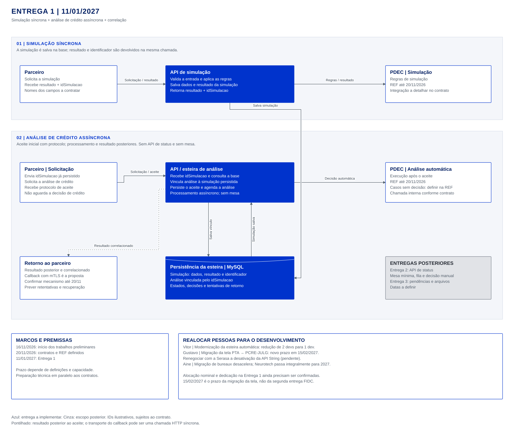

# Entrega 1 — Simulação e análise automática de crédito

Esta é a entrega anteriormente denominada Entrega 0. A estrutura completa passa a ter três entregas: **1 — APIs; 2 — API de status e análise julgamental mínima; 3 — pendências documentais e troca de arquivos**. Consulte a [tabela do épico e suas features](estrutura-projeto-nova-mesa.md). Os nomes dos arquivos foram preservados para manter os links existentes; os itens do recorte passam de E0 para E1.

**Data-alvo: 11/01/2027.** Entregar a API de simulação síncrona, a API de análise de crédito assíncrona e a correlação entre a simulação e a análise. A API de status e toda a mesa julgamental ficam para a segunda entrega, com data a definir.

Atualização: 12/11/2026. Recorte de implementação da [nova mesa FIDC](../modelos/proposta-nova-mesa.json), com rastreabilidade ao [backlog F3](cronograma-implementacao.md) e ao [backlog FIDC + documentos](../modelos/backlog-fidc-documentos.json). Este recorte passa a ser a referência de escopo para 11/01/2027; os cronogramas anteriores representam o cenário completo e não comprovam o prazo da Entrega 1.

## Visão da entrega

[Modelo da vista em JSON](../modelos/entrega-0-nova-mesa.json). É uma vista lógica de componentes e fluxos, seguindo o formato do repositório, não um modelo ArchiMate formal.

| Capacidade | Entrega 1 — 11/01/2027 | Segunda entrega — data a definir |
| --- | --- | --- |
| Simulação | API síncrona: salva dados e resultado na base e devolve resultado e identificador na mesma chamada | Evoluções a priorizar |
| Análise de crédito | API assíncrona e processamento da análise automática | Integração com decisão julgamental |
| Correlação | Vínculo persistido entre simulação, solicitação de análise e resultado | Reutilizar o vínculo nos fluxos posteriores |
| Retorno do resultado | Mecanismo assíncrono definido no contrato; callback é a proposta já presente no modelo | Evoluções a priorizar |
| API de status | Fora do escopo | Implementar consulta de andamento e resultado conforme contrato futuro |
| Mesa julgamental | Fora do escopo: sem fila, tela, analista ou decisão manual | Mesa PCRE-JULG, derivação, decisão e consolidação manual |

A análise é assíncrona de ponta a ponta: a resposta inicial confirma o aceite e fornece um identificador; o resultado chega posteriormente. Esse aceite não é o resultado de crédito. A chamada HTTP de callback pode aguardar confirmação de recebimento sem tornar síncrono o processamento da análise.

O controle interno de estados, a persistência e a observabilidade continuam necessários. Excluir a **API de status** significa excluir a consulta externa, não eliminar o estado interno da análise. O fluxo continua sem geração de proposta, formalização ou pagamento, conforme a delimitação do modelo FIDC.

## Premissas e marcos

A [versão 3 do one-page executivo](../output/pdf/one-page-executivo-entrega-1-v3.pdf) reúne o conteúdo executivo revisado, incluindo certificado mTLS enviado pelo parceiro até 12/12/2026 e priorização da modelagem da base de dados com o time de AD.

A [versão 2 do one-page executivo](../output/pdf/one-page-executivo-entrega-1-v2.pdf) apresenta estes marcos em cronograma linear e destaca os entregáveis: simulação síncrona persistida e análise automática assíncrona vinculada à simulação. **A Entrega 1 não terá análise manual**; a análise julgamental mínima entra na Entrega 2.

| Data / marco | Condição para a Entrega 1 | Evidência esperada |
| --- | --- | --- |
| **16/11/2026** | **Iniciar os trabalhos preliminares do time** | Levantamento de dependências, preparação técnica e planejamento de execução iniciados em paralelo à definição dos contratos e da REF |
| Até 20/11/2026 | Definir os contratos das APIs de simulação e análise, a correlação e o retorno assíncrono | Contratos versionados e acordados com consumidores, incluindo payloads, erros e exemplos |
| Até 20/11/2026 | Disponibilizar a REF das regras de simulação e análise automática envolvidas | Regras, entradas, saídas e cenários de aceite definidos com o negócio |
| **Até 24/11/2026** | **Definir a arquitetura da Entrega 1** | Desenho de componentes, integrações, persistência da simulação e vínculo com a análise definidos |
| A partir de 16/11/2026, com refinamento após 20/11 | Iniciar a realocação e o planejamento de capacidade; detalhar a implementação com os contratos e a REF definidos | Pessoas, dedicação, estimativas, ambientes e homologação confirmados |
| Até 11/01/2027 | Concluir a Entrega 1 | APIs e correlação homologadas e disponibilizadas conforme critérios de aceite |
| 15/02/2027 | Novo prazo da migração da tela de análise do PTA para a PCRE-JULG | Planejamento ajustado e dependência da API String renegociada com a Serasa |
| 2027, sem data específica | Migração Neurotech | Replanejamento da frente de bureaux |

O prazo de 11/01/2027 depende dos contratos e da REF em 20/11, da arquitetura da Entrega 1 definida até 24/11 e da disponibilidade efetiva da equipe. Férias, recessos, feriados, homologação do parceiro e janelas de implantação precisam entrar no plano de capacidade. Não há estimativa revisada suficiente para afirmar a viabilidade do prazo somente com o backlog anterior.

O [novo one-page executivo](../output/pdf/one-page-executivo-entrega-1.pdf) reúne os marcos, as premissas e os trade-offs. Propõe desenvolvimento entre 25/11 e 18/12, integração e correções entre 21 e 30/12 e homologação e preparação da implantação entre 04 e 08/01, para disponibilização em 11/01. Essas janelas intermediárias dependem da validação de capacidade e da agenda do parceiro; os marcos de 16/11, 20/11, 24/11 e 11/01 foram informados pelo planejamento.

## Trade-offs para realocação

Os nomes abaixo são as referências informadas para cada frente impactada; a composição nominal e a dedicação da equipe da Entrega 1 ainda precisam ser registradas.

| Frente impactada | Planejamento anterior | Ajuste necessário | Referência | Dependência / impacto |
| --- | --- | --- | --- | --- |
| Modernização da esteira de análise automática | 2 desenvolvedores | Reduzir para 1 desenvolvedor | Vitor | Desaceleração da modernização; novo prazo da frente a replanejar |
| Migração da tela de análise de crédito do PTA para a PCRE-JULG | Prazo anterior não informado neste recorte | Desacelerar e estender o prazo para **15/02/2027** | Gustavo | **Renegociar com a Serasa o prazo de desativação da API String**; renegociação ainda pendente |
| Migração de bureaux / Neurotech | Início da migração Neurotech previsto para 2026 | Transferir toda a migração Neurotech para **2027** | Aine | Desaceleração da frente de bureaux; datas detalhadas a replanejar |

A data de 15/02/2027 refere-se à migração da tela existente do PTA. Ela não é uma data de compromisso para a segunda entrega da nova mesa FIDC. A data de desativação da API String deverá ser acordada com a Serasa considerando a conclusão e a transição dessa migração; não se presume aceite do fornecedor.

## Trabalhos preliminares — início em 16/11/2026

O time inicia em **16/11/2026**, em paralelo à definição dos contratos e da REF, cujo prazo é **20/11/2026**. O início dos trabalhos não fica condicionado à conclusão dessas definições.

Atividades propostas para esse período: levantamento de dependências e acessos, inventário de ambientes e integrações, preparação de repositórios e CI/CD, desenho inicial da persistência e da correlação, cenários de teste e detalhamento do backlog e da capacidade. Preparações independentes dos contratos podem avançar; payloads, regras e decisões que dependem das definições devem ser consolidados após seu fechamento.

## Backlog proposto da Entrega 1

O escopo está consolidado em **duas features: FT-01 — API de simulação e FT-02 — API de análise de crédito assíncrona**. Correlação, retorno, segurança e confiabilidade integram essas features. O [Excel completo](../outputs/nova-mesa-20261112/backlog-completo-nova-mesa.xlsx) detalha as três entregas em atividades únicas; a tabela E1 abaixo permanece como agrupamento do recorte. Há também um [one-page para apresentação](../output/pdf/one-page-entrega-1-nova-mesa.pdf).

Os itens E1 abaixo organizam o recorte e seus critérios de conclusão. Não recebem automaticamente as durações nem as dependências da mesa do backlog F3. Esforço e responsáveis pela execução devem ser definidos no planejamento de capacidade.

| ID | Item | Depende de | Critério de conclusão |
| --- | --- | --- | --- |
| E1-00 | Iniciar trabalhos preliminares do time em 16/11 | — | Levantamento técnico, dependências, acessos e plano inicial de execução iniciados em paralelo a E1-01 e E1-02 |
| E1-01 | Fechar contratos de simulação, análise, correlação e retorno assíncrono até 20/11 | — | Payloads, aceite, resultado, erros, identificadores, idempotência e mecanismo de retorno acordados |
| E1-02 | Fechar a REF das regras de simulação e análise automática até 20/11 | — | Cenários e regras definidos, incluindo situações sem decisão automática e sem mesa disponível |
| E1-03 | Preparar arquitetura, ambientes, persistência, segurança e CI/CD do recorte | E1-00, E1-01 | Recursos e acessos necessários disponíveis; mTLS do modelo detalhado; execução assíncrona e armazenamento definidos |
| E1-04 | Implementar a API de simulação síncrona | E1-01, E1-02, E1-03 | Simulação e resultado salvos na base; resultado e identificador retornados na mesma chamada; validações, erros e timeout conforme contrato |
| E1-05 | Implementar o aceite da análise assíncrona e a correlação com a simulação | E1-01, E1-03 | Solicitação persistida, vínculo válido com a simulação e identificador de análise devolvido sem aguardar a decisão |
| E1-06 | Executar a análise automática e persistir o resultado | E1-02, E1-05 | Integração com a PDEC e estados internos funcionando; tratamento dos casos sem decisão conforme REF, sem acionar mesa |
| E1-07 | Implementar o retorno assíncrono ao parceiro | E1-01, E1-06 | Resultado entregue pelo mecanismo contratado com identificadores de simulação e análise; falhas de entrega recuperáveis |
| E1-08 | Garantir idempotência, tratamento de falhas e rastreabilidade | E1-04, E1-05, E1-06, E1-07 | Reenvios não duplicam análises nem sobrescrevem decisões finais; tentativas e correlação observáveis |
| E1-09 | Homologar o fluxo completo e os cenários de falha | E1-08 | Simulação → análise → resultado validado com o parceiro; carga e resiliência verificadas conforme requisitos acordados |
| E1-10 | Preparar operação e disponibilizar a Entrega 1 até 11/01/2027 | E1-09 | Aceite do negócio, monitoramento, runbook, implantação e rollback preparados |

E1-04 e E1-05 podem ser desenvolvidos em paralelo após as definições comuns, usando contratos e exemplos acordados. A homologação precisa validar o vínculo real entre ambos. As dependências indicam condições de conclusão; não representam uma estimativa de calendário.

### Correlação e aceite funcional

Proposta para detalhamento contratual até 20/11; os nomes de campos abaixo são ilustrativos:

1. A API de simulação salva os dados e o resultado na base MySQL e retorna seu resultado e um `idSimulacao` estável.
2. A API de análise recebe esse identificador, consulta a simulação persistida e vincula a análise de crédito a ela. O contrato define validade da simulação, titularidade, compatibilidade dos dados e se uma simulação admite uma ou mais análises.
3. O aceite da análise devolve um `idAnalise` ou protocolo e confirma o vínculo com `idSimulacao`. A associação fica persistida e pode ser rastreada internamente.
4. O resultado posterior permite identificar a análise e a simulação de origem. Reenvios preservam essa associação.
5. Os testes cobrem referência inexistente, expirada, incompatível ou de outro parceiro, além de repetição de requisições, indisponibilidade da PDEC e falhas no retorno.

### Rastreabilidade do backlog anterior

| Itens de origem | Tratamento no recorte |
| --- | --- |
| F3-01, F3-03, F3-06, F3-07, F3-08, F3-10 | Adaptar ao desenho, infraestrutura e segurança da Entrega 1 (E1-03) |
| F3-02, F3-05 | Adaptar contratos e política de retorno; incluir simulação e correlação (E1-01) |
| F3-16, F3-17 | Adaptar para aceite da análise assíncrona, persistência e vínculo com simulação (E1-05) |
| F3-18, F3-19 | Manter estados e decisão automática no recorte, retirando dependência da mesa (E1-06) |
| F3-21, F3-27 | Adaptar idempotência e proteção da decisão automática; remover a dependência de F3-26 (E1-08) |
| F3-28, F3-29 | Adaptar retorno do resultado e recuperação de falhas, conforme contrato (E1-07 / E1-08) |
| F3-11, F3-30 | Manter observabilidade e auditoria com correlação entre simulação e análise (E1-08) |
| F3-12, F3-13, F3-14, F3-15 | Replanejar testes, operação e disponibilização para o recorte sem mesa (E1-09 / E1-10) |
| F3-04, F3-20, F3-22, F3-23, F3-24, F3-25, F3-26 | Segunda entrega: extensão PCRE-JULG, derivação, fila, tela, acesso, decisão e consolidação manual |
| F3-09 | Provisionamento Kafka para a mesa fica na segunda entrega; eventual uso para execução automática deve ser decidido e dimensionado em E1-03 |
| D3-01 a D3-16 | Entrega 3: pendências documentais, troca de arquivos e retomada da análise; data a definir |
| Novos itens sem equivalente explícito no F3 | Simulação síncrona (E1-04), REF (E1-02), correlação (E1-01 / E1-05) e API de status na segunda entrega |

## Backlog da segunda entrega

| Bloco | Conteúdo | Prazo |
| --- | --- | --- |
| API de status | Consulta externa de andamento e resultado, com autorização e correlação | A definir |
| Mesa julgamental | Integração com PCRE-JULG, fila única FIDC, tela, perfis e registro da decisão manual | A definir |
| Integração da decisão manual | Derivação, eventos, consumo e consolidação da decisão, com idempotência | A definir |
| Validação da ampliação | Homologação, operação e implantação dos novos fluxos | A definir |

Na Entrega 2, a mesa permite receber, consultar e decidir solicitações em fila única FIDC. A ação de pendenciar e a troca de arquivos entram na Entrega 3.

## Backlog da terceira entrega

| Bloco | Conteúdo | Prazo |
| --- | --- | --- |
| Pendência documental | Registrar motivo, documentos exigidos, prazo e versão da pendência; notificar o parceiro | A definir |
| Troca de arquivos | Autorizar envio, armazenar em ambiente privado, validar arquivos e permitir correção e reenvio | A definir |
| Consulta documental | Disponibilizar arquivos válidos e histórico ao analista autorizado, com auditoria | A definir |
| Retomada da análise | Consolidar documentos obrigatórios e retomar uma única vez por versão ativa da pendência | A definir |
| Validação da ampliação | Homologar os fluxos documentais e implantar com monitoramento e rollback | A definir |

A Entrega 3 corresponde à extensão D3-01 a D3-16 do backlog existente e depende da mesa mínima da Entrega 2. Não faz parte do compromisso de 11/01/2027.

## Definições ainda necessárias

- **Até 20/11 — negócio / REF:** decidir o comportamento para casos sem decisão automática. Não presumir aprovação, rejeição ou encaminhamento a uma mesa que não estará disponível.
- **Até 20/11 — contratos:** confirmar o canal de entrega do resultado. A referência atual propõe callback com mTLS; detalhar confirmação, timeout, retentativas, recuperação e responsabilidades do parceiro, pois não haverá API de status.
- **Até 20/11 — correlação:** definir validade, cardinalidade, titularidade e comportamento diante de mudanças entre a simulação e a análise.
- **Planejamento de execução:** confirmar equipe realocada, dedicação, estimativas e calendário de homologação e implantação. Os nomes das frentes impactadas não substituem essa alocação.
- **Dependência externa — Serasa:** formalizar a renegociação da desativação da API String para viabilizar o novo prazo da migração PTA → PCRE-JULG.

Se contratos, REF ou capacidade não se confirmarem, o impacto sobre 11/01/2027 deverá ser reavaliado explicitamente.
